# Описание работы · ТЗ № ТЗ-04/2026 · «Белая линия»

**Исполнитель:** Константинов Валерий Владимирович, группа РПО 25/9/3
**Сайт:** https://white-line-sooty.vercel.app
**Период проверок:** 1–28 октября 2026, кадр воронки — 29 октября 2026, публикации Instagram — 29 октября 2026

## 1. Задача заказчика

Компания «Белая линия» принимает около 1 100 пациентов в месяц, из них 210 — новые. Новые пациенты записываются по телефону, через Instagram и ВКонтакте. В сентябре 2026 года в соцсети написали 260 человек, записались 118. Клиника не знает, сколько пришло по рекламе, а сколько по рекомендации. На продвижение уходит 65 000 ₽ в месяц: 45 000 ₽ на соцсети и 20 000 ₽ на листовки. С 1 ноября 2026 года нужна акция «профессиональная гигиена и консультация за 3 900 ₽», сайт с записью и одна таблица, где у каждой заявки есть источник.

## 2. Схема работы

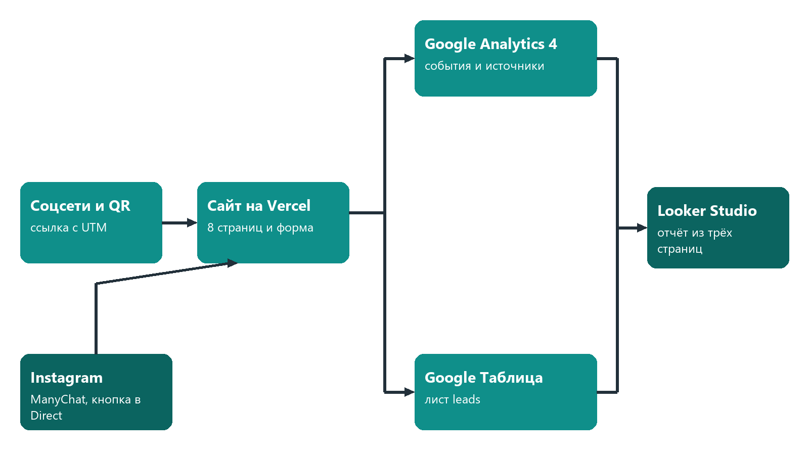

Посетитель приходит из соцсетей или по QR-коду по ссылке с UTM-метками. Сайт на Vercel отправляет события в GA4, а заявку — в Google Таблицу через Apps Script. Данные GA4 и таблицы собираются в отчёте Looker Studio. Кнопка ManyChat ведёт на тот же сайт. HubSpot в цепочку не входит.

## 3. Сайт

Сайт из 8 страниц и `404.html` создан в Cursor и доработан вручную: форма записи, события только в `js/analytics.js`, порядок блоков по приложению А. Опубликован на Vercel.

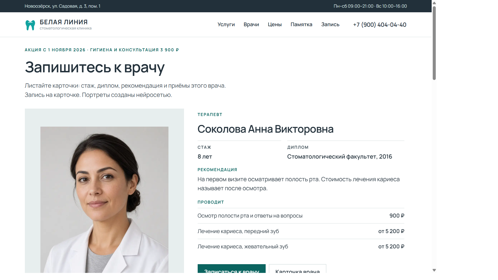
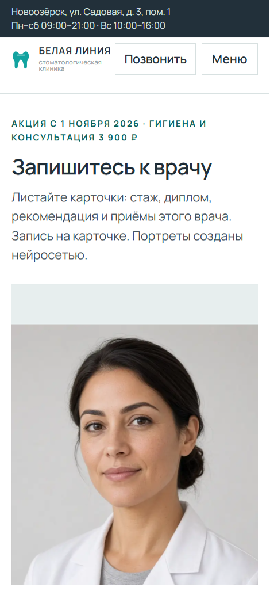
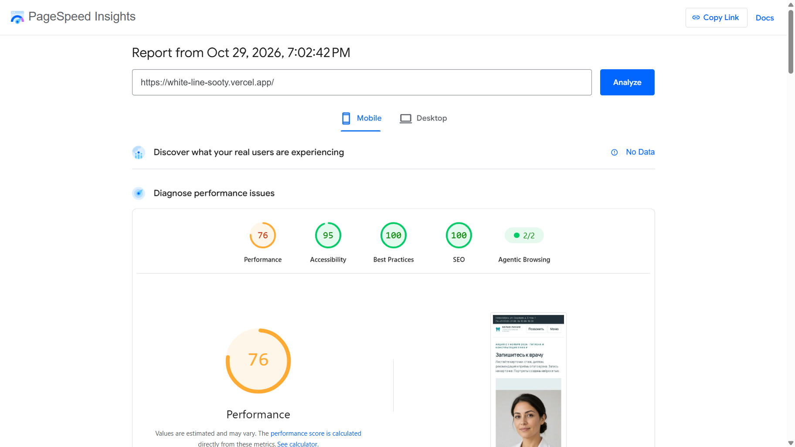

Lighthouse главной, мобильный режим, 29 октября 2026: Performance 76, Accessibility 95, SEO 100.

## 4. Аналитика GA4

Настроено 20 событий: 6 собирает расширенная статистика, 14 своих отправляет `js/analytics.js`. Ключевые события: `generate_lead`, `contact_click`, `messenger_click`. Пользовательских определений параметров — 7: `button_name`, `page_section`, `service_name`, `specialty`, `search_term`, `lead_service`, `messenger`. Ресурс `G-7BTPH14B6G`. В коде `debug_mode` выключен. Снимки DebugView лежат в `screens/ga4/`.

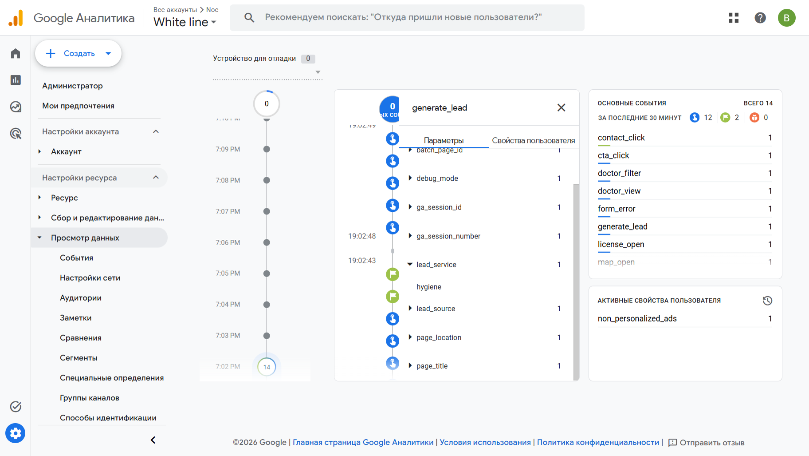

## 5. UTM-ссылки и соцсети

В реестре 12 ссылок.

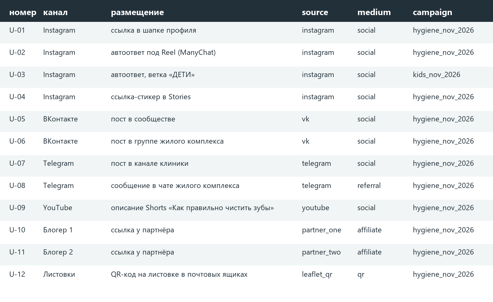

Опубликованы два поста Instagram от 29 октября 2026. Для ВКонтакте, Telegram и YouTube есть размеченные ссылки, отдельных страниц этих каналов нет. QR для листовки собран. Ники партнёров `partner_one` и `partner_two` не заменены.

В обработанном отчёте Traffic acquisition за 1–28 октября 2026 три пары источник/канал и 10 сеансов: `(direct) / (none)` — 5, `vercel.com / referral` — 4, `yandex / organic` — 1. Ключевых событий 0.

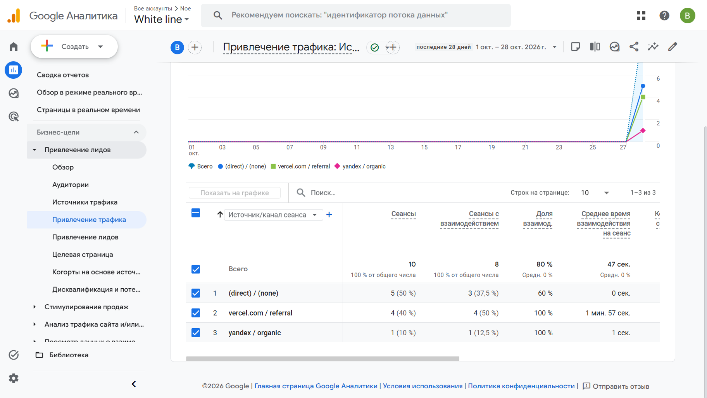

## 6. Заявки

Форма отправляет заявку в Apps Script. Скрипт проверяет поля, сам ставит дату и статус `new`, повторный `request_id` не пишет второй строкой. За период отчёта в листе `leads` одна заявка от 28 октября 2026, статус `new`. На кадре имя, телефон и почта закрыты. Форма на соседнем кадре заполнена и не отправлена, чтобы не создавать вторую строку.

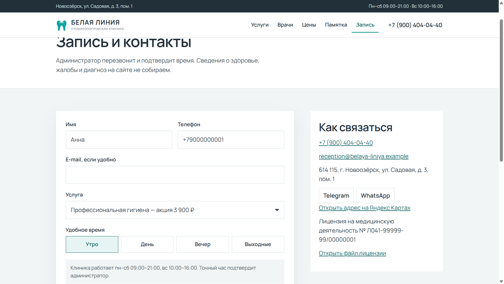
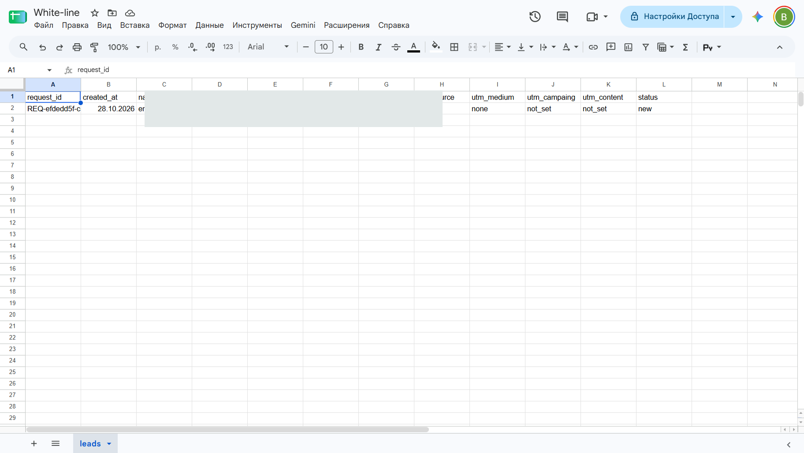

Событие `generate_lead` за 1–28 октября в отчёте GA4 равно 0: строка в таблице есть, ключевое событие за тот период в отчёт не попало.

## 7. Автоответы в Instagram

Комментарий «ЧЕК» под постом гигиены запускает ответ и сообщение в Direct с кнопкой «Открыть памятку» на ссылку U-02. Слово «ДЕТИ» под постом детского приёма ведёт кнопкой «Детский приём» на ссылку U-03. Обе автоматизации Live: `IG · Hygiene Nov 2026 · Reel 01` и `IG · Kids Nov 2026 · Post 01`.

30 октября 2026 со второго аккаунта в Direct пришли оба сообщения. Кнопка «Открыть памятку» открыла памятку с кампанией `hygiene_nov_2026`. Кнопка «Детский приём» открыла страницу услуг с кампанией `kids_nov_2026`.

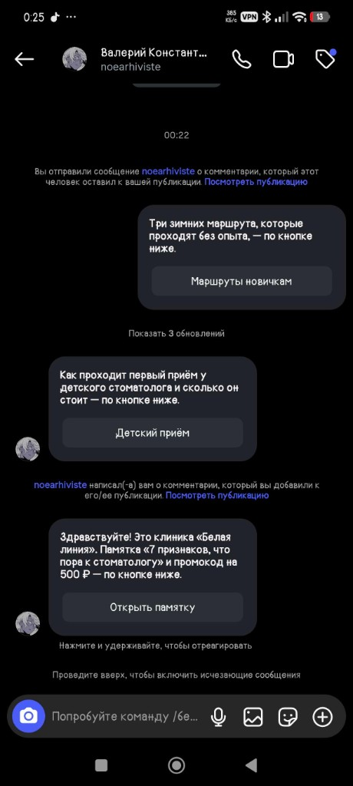
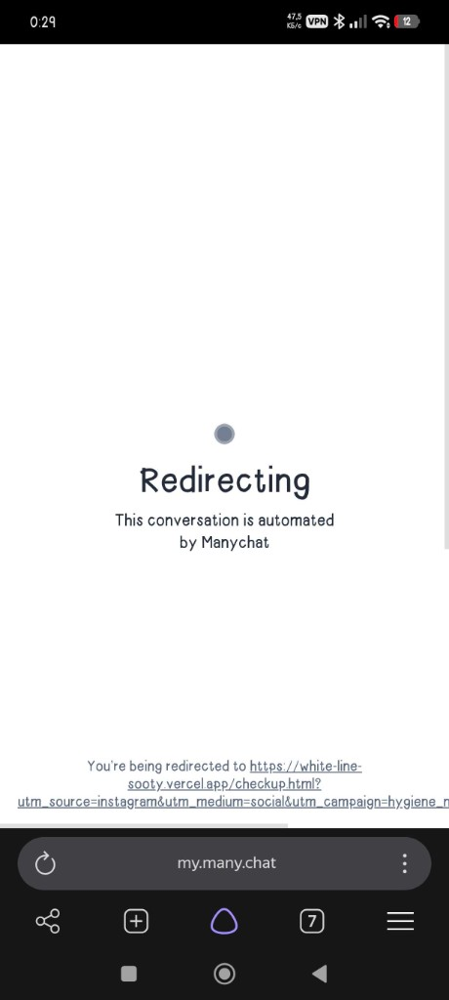
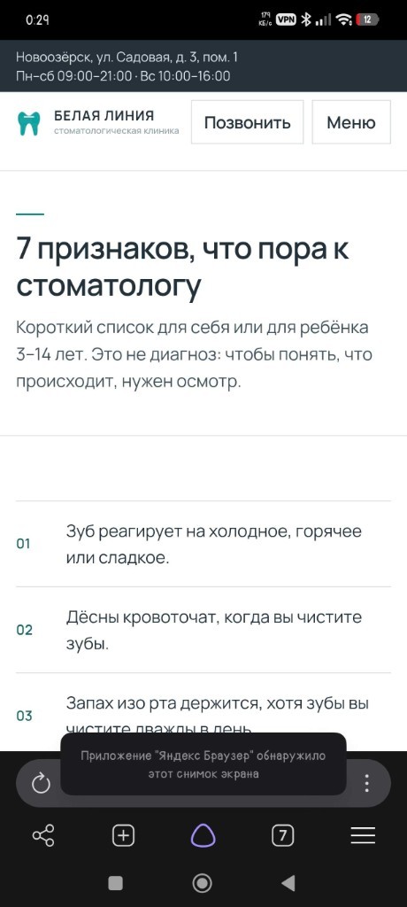
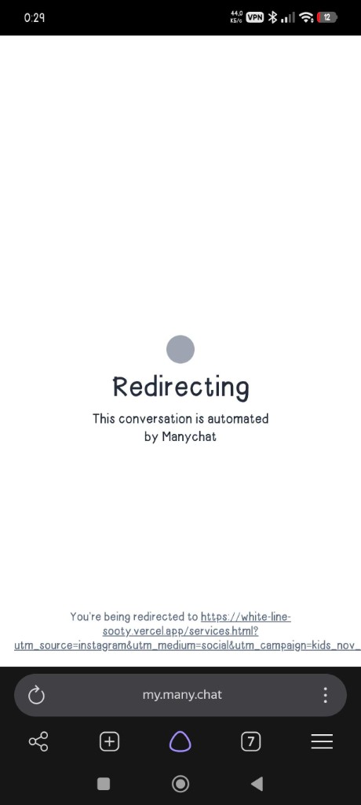
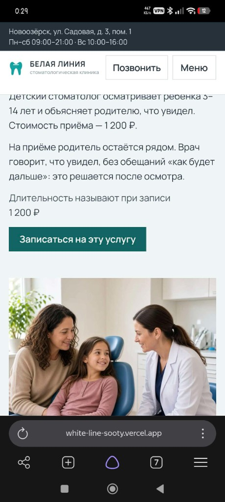

## 8. Отчёты и дашборд

На кадре исследования «БЕЛАЯ ЛИНИЯ · Воронка» от 29 октября 2026, диапазон «сегодня», наибольшая потеря между `page_view` и `cta_click`: 3 пользователя на первом шаге и 0 дальше, потеря 100 %. В записке за 1–28 октября на `page_view` было 4 пользователя, дальше тоже 0.

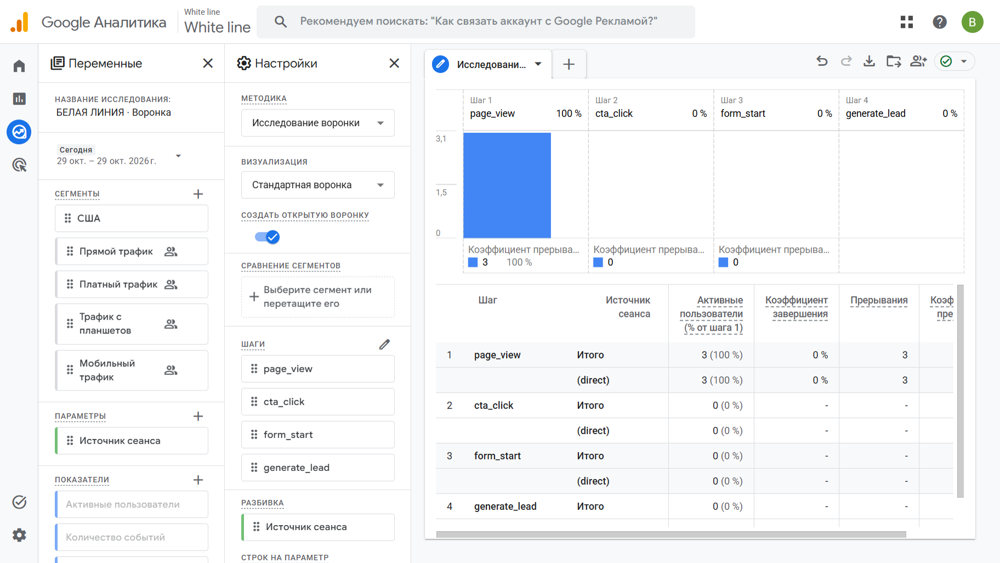

В таблице одна заявка с источником `direct`. На странице кампаний Looker Studio конверсия пустая: GA4 пишет `(direct)`, таблица — `direct`, склейка их не соединила.

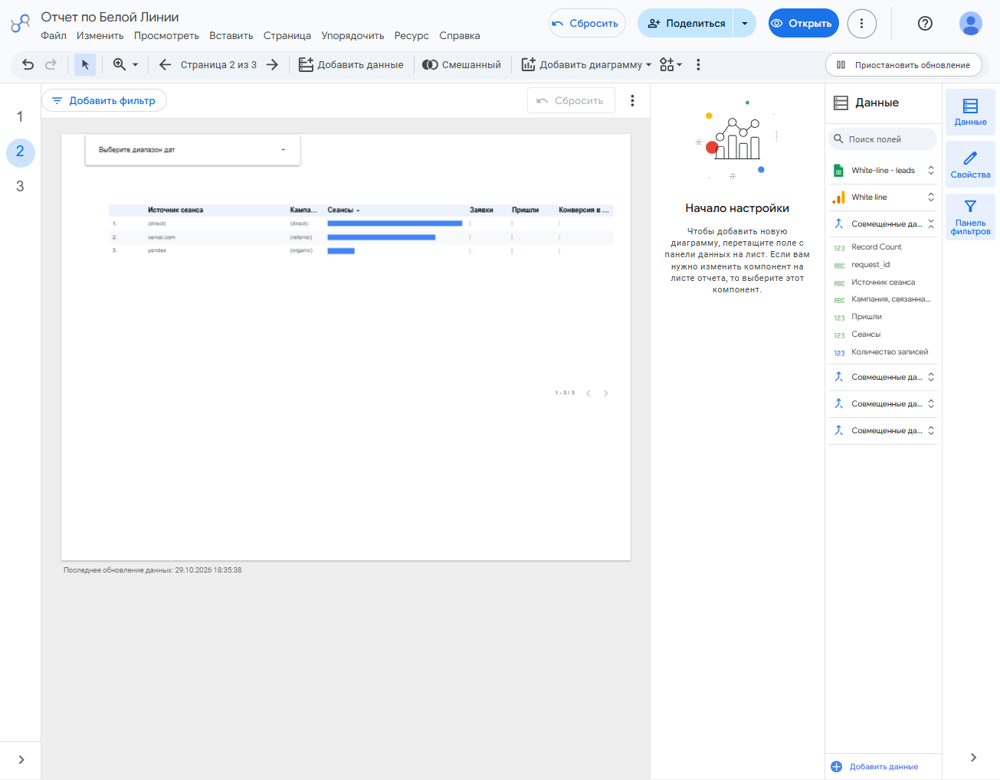

## 9. Что получил бизнес

| Было | Стало |
|---|---|
| заявки в телефоне, Instagram и ВКонтакте | заявка с сайта пишется в одну таблицу со статусом |
| источник пациента неизвестен | у заявки есть поля source, medium, campaign |
| 65 000 ₽ в месяц без понимания, что окупается | в Looker Studio видны сеансы по каналам и заявки |
| ответы на комментарии вручную | ManyChat отвечает на «ЧЕК» и «ДЕТИ» и ведёт на сайт |

Рекомендация заказчику: на странице памятки поставить кнопку записи первым видимым действием и снова снять воронку. Переносить 45 000 ₽ между каналами по этим данным рано: заявка в таблице одна и в GA4 за период записки не подтверждена `generate_lead`.

## 10. Итог

Не получилось: отдельные страницы ВКонтакте, Telegram и YouTube; страница Instagram `belaya_liniya_dent`; разные сообщения на одном посте; кадр самого комментария под постом; замена ников партнёров; доступ Viewer в GA4 по почте (ссылки «для всех» в GA4 нет); HubSpot. Таблица и Looker Studio открыты всем, у кого есть ссылка, с правом читателя.

ИИ использовался для: структуры сайта, текстов, вёрстки, портретов врачей, PDF, QR, схемы и журнала запросов в `docs/prompts.md`.
